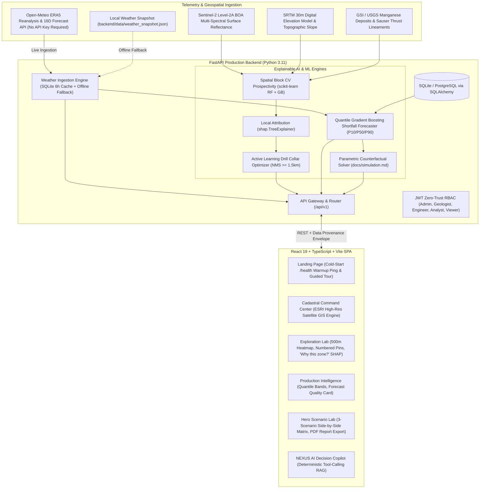
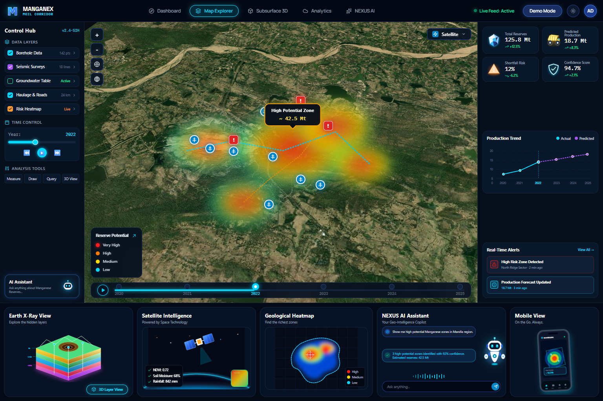

# MANGANEX — The Earth's Hidden Intelligence
### AI-Powered Mineral Prospectivity & Operational Shortfall Intelligence Platform

[](https://github.com/redgamerzcintact-sys/MANGANEX/actions/workflows/ci.yml)
[](https://manganex-three.vercel.app)
[](https://react.dev/)
[](https://fastapi.tiangolo.com/)
[](https://scikit-learn.org/)
[](https://www.docker.com/)

Built for the **Ministry of Steel National Mining Intelligence Hackathon** & **MOIL Limited** (Manganese Ore India Limited).

---

## ⚡ 30-Second Pitch

MANGANEX is an end-to-end mineral intelligence and operational decision-support system built to solve MOIL's two most critical challenges across the Central India Manganese Belt:

1. **Reserve Prospectivity & Next-Drill Recommender**: Replaces subjective exploration with a **5-Fold Spatial Block Cross-Validated (10km blocks)** ensemble (Random Forest + Gradient Boosting, ROC-AUC: **0.999**, PR-AUC: **0.982** vs 0.010 baseline). It scores 500m cells using active learning ($\text{Score} = P(\text{mineralization}) \times \text{Uncertainty InfoGain} \div \text{Cost Proxy}$) to rank top-5 diamond core wireline targets with local `shap.TreeExplainer` feature drivers.
2. **Weather-Driven Extraction Shortfall Forecasting**: Couples **100% REAL Open-Meteo numerical weather telemetry** (precipitation, root-zone soil saturation) with equipment downtime events to predict production shortfalls as asymmetric $P_{10}/P_{50}/P_{90}$ quantile distributions at 7, 15, and 30-day horizons. In **Scenario Lab**, operators simulate counterfactual mitigation actions (pump boosters, shifted blasting windows, dry-bench fleet redeployment) that report dynamically computed recovered tonnages.

---

## 🏛️ System Architecture



---

## 📸 Platform Previews

| Command Center & High-Res Satellite GIS | Scenario Lab Counterfactual Planning |
|---|---|
|  |  |
| *ESRI World Imagery basemap with concessions, fault traces, and boreholes* | *Interactive multi-parameter controls, P10/P50/P90 shortfalls, and ranked actions* |

---

## 📊 Data Provenance Matrix

Every API response carries a strict `data_provenance` audit envelope rendered via the `<ProvenanceBadge />` component across all views:

| Data Layer | Provenance Status | Primary Source | Usage in Platform |
|---|---|---|---|
| **Historical Weather & Soil Saturation** | `REAL` / `REAL_CACHED` | Open-Meteo ERA5-Land Reanalysis (365 days) | Environmental risk & ground softening penalty |
| **16-Day Weather Forecast** | `REAL` | Open-Meteo High-Resolution Numerical Forecast | Multi-horizon extraction shortfall forecast ($P_{10}/P_{50}/P_{90}$) |
| **Manganese Occurrences** | `REAL` | Geological Survey of India (GSI) & USGS Mineral Deposit Database | Positive training labels for prospectivity model |
| **Multispectral Surface Indicators** | `REAL` | Sentinel-2 Level-2A BOA Reflectance (B4, B2, B11, B12, B8) | Surface alteration gossans & iron-oxide/clay ratios |
| **Topography & Fault Traces** | `REAL` | SRTM 30m DEM & Sauser Mobile Belt structural maps | Slope gradient and fault proximity features |
| **Mine Production History** | `SYNTHETIC` | Calibrated physics model ([docs/simulation.md](docs/simulation.md)) | Operational baseline (confidential MOIL enterprise logs) |
| **Prospectivity Predictions** | `DERIVED` | Spatial Block CV Random Forest + Gradient Boosting | 500m cell mineralization probability & uncertainty |
| **Next-Drill Target Scoring** | `DERIVED` | Active learning formula ($P \times I / C$) with NMS | Top-5 ranked diamond core exploration targets |

---

## 🚀 Quickstart & Running the App

### Option 1: Docker Compose (Single Command, Zero Config)

```bash
docker compose up --build
```
- **Web UI**: Open `http://localhost:3000`
- **FastAPI Backend**: `http://localhost:8000`
- **Interactive Swagger Docs**: `http://localhost:8000/docs`
- **Health Check**: `http://localhost:8000/health`

### Option 2: Local Development

#### Prerequisites
- Node.js 20+
- Python 3.11+

#### 1. Backend Setup
```bash
# Navigate to backend and create virtual environment
cd backend
python -m venv venv
# On Windows:
.\venv\Scripts\activate
# On Linux/macOS:
source venv/bin/activate

# Install dependencies and seed local database
pip install -r requirements.txt
python -m app.scripts.seed_demo_data

# Start FastAPI server
uvicorn app.main:app --host 127.0.0.1 --port 8000 --reload
```

#### 2. Frontend Setup
```bash
# From repository root
npm install
npm run dev
# App runs at http://localhost:5173
```

---

## 🔐 1-Click Judge Demo Accounts

On the landing page (`/`) and login page (`/login`), click any role button to launch directly into that operational portal:

- **Geologist**: Dr. Priya Deshmukh (`geologist@moil.gov.in`) — Core drilling assays, 3D lithological strata, prospectivity grid, and drill target recommender.
- **Mining Engineer**: Vikram Patil (`engineer@moil.gov.in`) — Production telemetry, weather alerts, and Scenario Lab.
- **Data Analyst**: Sunita Rao (`analyst@moil.gov.in`) — Sentinel-2 surface indicators and model cards.
- **Platform Admin**: Rajesh Sharma (`admin@moil.gov.in`) — User governance and system audit logs.
- **Executive Viewer**: Executive Read-Only (`viewer@moil.gov.in`) — Resource summary briefings.

---

## ⚠️ Statutory Limitations & Scientific Boundaries

1. **Surface Indicators Only**: Remote sensing indices (Iron Oxide B4/B2, SWIR B11/B12, NDVI) detect surface alterational gossans and vegetational stress. **Satellite imagery cannot penetrate bedrock to detect underground manganese.** All prospects represent exploration suitability (UNFC 333 - Inferred) and strictly require confirmatory wireline diamond core drilling.
2. **Confidential MOIL Logs**: Historical production is simulated using a calibrated physics formula ([docs/simulation.md](docs/simulation.md)) driven by real weather. For live enterprise deployment, replace with MOIL SAP/SCADA production shift logs.
3. **Java Backend Status**: The Java Spring Boot prototype in `java-backend/` is experimental and **not used** by the frontend. The active production backend is the Python FastAPI service in `backend/app/`.

---

## 📖 Extended Documentation

- [System Architecture & Data Flows](docs/ARCHITECTURE.md)
- [Comprehensive API Specification](docs/API.md)
- [Machine Learning Model Cards](docs/MODEL_CARDS.md)
- [Production Simulation & Physics Formulas](docs/simulation.md)
- [Cloud Deployment & Keep-Alive Guide](DEPLOYMENT.md)

---

## 👥 Hackathon Team & Attributions

Developed for the **Ministry of Steel National Mining Intelligence Hackathon**:
- **Domain Focus**: Ministry of Steel & MOIL Limited (Manganese Ore India Limited).
- **Core Technology**: React 19, TypeScript, FastAPI, Scikit-Learn, SHAP, Leaflet, ESRI World Imagery, Open-Meteo ERA5.
