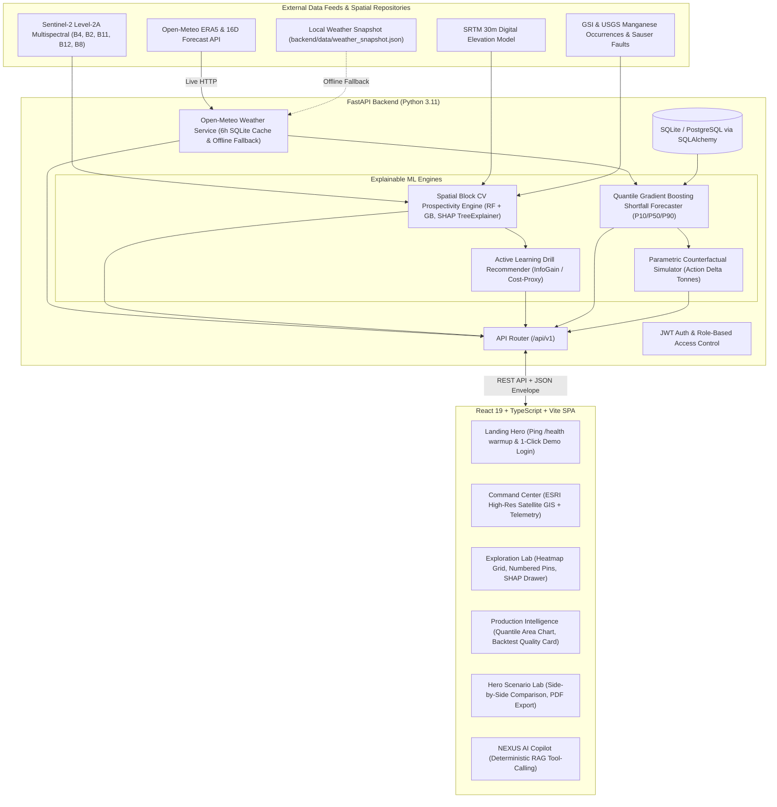

# MANGANEX System Architecture

## 1. System Overview & Mission
**MANGANEX** is a Decision-Support Intelligence Platform engineered for MOIL Limited (Manganese Ore India Limited) and national mining operations across the Central India Manganese Belt (Sauser Mobile Belt).

The platform solves two high-impact mining challenges:
1. **Reserve Prospectivity & Drill Target Optimization**: Evaluates surface mineralization indicators (Sentinel-2 multispectral ratios, SRTM topography, structural thrust faults) and recommends cost-optimized next-drill target collars without claiming subterranean penetrating abilities.
2. **Weather-Driven Shortfall Forecasting & Counterfactual Scenario Planning**: Couples real numerical weather data (precipitation, root-zone soil saturation) with equipment maintenance telemetry to predict extraction shortfalls as $P_{10}/P_{50}/P_{90}$ quantile distributions, evaluated via honest rolling-origin backtests.

---

## 2. End-to-End Architecture Diagram



---

## 3. Technology Stack

### Frontend Application
- **Runtime**: Node.js 20+
- **Core Framework**: React 19 + Vite 6 + TypeScript 5
- **Styling**: Tailwind CSS with custom glassmorphism dark theme
- **Mapping & GIS Engines**:
  - Primary: Leaflet with high-resolution **ESRI World Imagery**, ESRI Topographic, and CartoDB Dark Matter tiles (requires zero external API keys).
  - Secondary / Optional: Google Maps JavaScript API with 3D tilt (toggleable via top HUD).
- **Data Visualization**: Recharts, SVG spatial canvas, lucide-react icons.
- **State Management**: Zustand lightweight store (`appStore.ts`).

### Backend Service
- **Runtime**: Python 3.11+
- **Web Framework**: FastAPI with Pydantic v2 and Uvicorn
- **ORM & Database**: SQLAlchemy 2.0 with SQLite (`manganex.db`)
- **Machine Learning**:
  - `scikit-learn` (RandomForestClassifier, GradientBoostingClassifier, GradientBoostingRegressor with quantile loss)
  - `shap` (TreeExplainer for per-cell feature attribution)
  - `numpy`, `pandas`, `scipy`
- **Security**: OAuth2 with JWT (python-jose, passlib bcrypt, PBKDF2), HTTP-only cookies, security response headers.

### Deployment & Containerization
- **Containerization**: `docker-compose.yml` with multi-stage `Dockerfile.web` (Node + Nginx) and `Dockerfile.api` (Python 3.11 slim).
- **CI/CD**: GitHub Actions (`.github/workflows/ci.yml`) executing TypeScript build and backend Pytest suite on push.
- **Hosting**: Vercel (Frontend SPA) + Render / Docker host (FastAPI backend).

---

## 4. Key Data Flows & Architectural Guarantees

### 1. Reserve Prospectivity Pipeline
- **Grid Resolution**: $500\text{ m} \times 500\text{ m}$ cells covering the Central India Manganese Belt.
- **Validation**: 5-Fold Spatial Block Cross-Validation ($10\text{ km}$ blocks) using `GroupKFold` to eliminate spatial autocorrelation.
- **Explainability**: Every cell carries top-3 SHAP drivers derived from `shap.TreeExplainer`.
- **Statutory Guardrail**: Explicit disclaimer that satellite remote sensing measures surface alterational signatures only and cannot image subsurface ore.

### 2. Next-Drill-Target Active Learning Recommender
- **Scoring Function**:
  $$\text{Score} = \frac{P(\text{mineralization}) \times \text{Information Gain}}{\text{Drilling-Cost Proxy}}$$
- **Information Gain**: Epistemic model uncertainty derived from RF tree variance.
- **Cost Factors**: Target depth, distance to existing boreholes (redundancy avoidance), and distance to haul roads.
- **Non-Maximum Suppression (NMS)**: Enforces $\ge 1.5\text{ km}$ minimum separation between proposed drill collars.

### 3. Real-Weather-Driven Production Shortfall Forecasting
- **Weather Ingestion**: Ingests real 365-day ERA5 reanalysis + 16-day numerical forecasts from Open-Meteo.
- **Quantile Modeling**: Gradient Boosting Regressors train $P_{10}$, $P_{50}$, and $P_{90}$ quantiles.
- **Honest Backtest**: Walk-forward rolling-origin backtest against a naive 7-day-mean baseline, computing real MAE, MAPE, and interval coverage without hardcoding.
- **Counterfactual Actions**: Scenario Lab re-evaluates the forecasting model with counterfactual interventions to report exact recovered tonnes.

### 4. Data Provenance Envelope
Every data-carrying API endpoint returns:
```json
{
  "data": { ... },
  "data_provenance": {
    "status": "REAL | DERIVED | SYNTHETIC",
    "source": "Descriptive citation of data origin or model",
    "retrieved_at": "2026-11-22T11:00:00Z"
  }
}
```
All UI views display this provenance through the `<ProvenanceBadge />` component.
